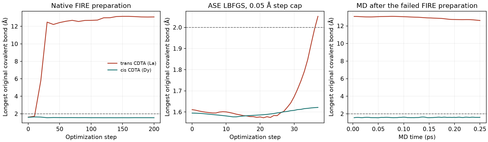

# Bounded neutral cis/trans Tauri evaluation — 9 November 2026

1. **What predicts selectivity best?** Donor counts plus charge remain the established independent baseline: historical family-held-out RMSE **0.854 kcal/mol** on 115 ligands. Tauri produced no admissible selectivity prediction.
2. **Did topology add value?** The earlier evaluation found no supported gain (RMSE 0.854 → 0.882). Those fits were not rerun in this physical pilot.
3. **Did 3D add value beyond topology?** Not demonstrated. The earlier MMFF increment was unstable; this Tauri setup failed intact-ligand preparation before an affinity calculation could be evaluated.
4. **Was the published-model comparison independent?** No. The earlier graph model's 0.563 RMSE has extensive ligand, family and protonation-record exposure. This pilot changes neither that audit nor its unresolved clean comparison.
5. **What single next action is justified?** **Stop this Tauri setup and retain M1.** The classification is **data/validation insufficient for the intended intact-ligand selectivity observable**. Longer sampling is not released.

The historical predictive results above come from the completed [structural-increment report](../ln_structure_increment_20261030/REPORT.md). The results below were generated or reproduced in this continuation.

## Decisive finding: the target ligand changes chemistry

The native preparation damaged the trans-CDTA carboxylate group before MD. Atom order, initial coordinates under periodic wrapping, and checkpoint/HDF5 correspondence were verified against the real input. The first damaged saved frame is optimization step 20; step 10 was intact. This is an observation interval, not an exact intervening scission time.

All indices below are zero-based global atom indices in the original input:

| Original trans600 bond | Initial distance, Å | After native FIRE, Å | After 0.25 ps MD, Å |
|---|---:|---:|---:|
| C6–C7 | 1.548 | 5.502 | 5.356 |
| C7–O8 | 1.270 | 13.076 | 12.617 |
| C7–O9 | 1.277 | 4.727 | 5.514 |

A single independent ASE-only comparison used the unchanged L potential, a 0.05 Å maximum atom displacement, standard LBFGS and the same 200-step limit. It crossed the existing 2 Å integrity threshold for **C6–C7 at step 37 (2.052 Å)** and stopped. Every accepted atom step stayed within 0.05 Å. This comparison did not execute another MD trajectory or qualify the native interface. It cannot be described as completed bond scission, because it stopped at the declared threshold.



The 0.25 ps trajectory therefore samples a changed chemical species. Its temperature approached 298 K and it completed numerically, but it cannot answer the requested selectivity of intact CDTA. Distance counts after this damage are contacts among original labeled atoms, not validated ligand denticity. Proton-transfer candidates are retained; no equilibrium species or affinity is inferred from them.

These results do not identify a unique cause among the potential, starting coordination/charge context and preparation behavior. They suffice to withhold this setup from further selectivity sampling. No claim is made that all Tauri uses fail or that structure contains no predictive information.

## What passed, and what remained unqualified

| Check | Actual result | Interpretation |
|---|---|---|
| Neutral finite-system distant-water control | Maximum swap change 0.00694 kcal/mol; limit 0.5 | Passed on three preparations |
| Real directional finite difference | Residual 3.52e-8 kcal/mol/Å; tolerance 0.003 | Passed numerical consistency check |
| CPU versus GPU, two identical full-box endpoints | Energy differences 0; force differences ≤1.26e-10 eV/Å | Passed 1e-5 numerical tolerances |
| Full periodic original boxes | Maximum swap changes 0.01127, 0.01560, 0.00375 kcal/mol | All three pass 0.5 robustness criterion |
| Hydrated start0 periodic controls | Maximum swap change 0.02439 kcal/mol | Passed the same criterion |
| Native checkpoint versus ASE force bridge | Maximum difference 1.964e-5 eV/Å versus 1e-5 tolerance | Failed strict numerical qualification; retained |
| Native intact-ligand preparation | Three original trans covalent bonds separate | Failed chemical integrity |
| Capped ASE preparation | C6–C7 reaches 2.052 Å at step 37 | Failed the existing integrity range |

Energy cancellation leaves force sensitivity: removing the hydrated remote water changes the two metal force-difference vectors by 0.119/0.159 kcal/mol/Å. Water removal also changes real electrostatics, so these values do not uniquely identify a model defect or prove locality. The force-bridge miss is about 0.000453 kcal/mol/Å; its tolerance was not raised. No force-qualified comparison is claimed from that failed gate.

The bridge stopped the combined comparison before optimization. The subsequent capped run was explicitly declared as an independent ASE-only diagnostic under one energy/gradient implementation. See [the protocol and deviation record](PREPARATION_COMPARISON.md).

## Inputs, states and settings

The frozen [plan](PLAN.md) and dated [hydration repair](HYDRATION_PREPARATION.md) define the inputs. Three preparations use the exact curated cis599/trans600 graphs and archived ligand conformers 0/1/2. Both ligands start as L4− with neutral tertiary amines. Relative stereochemistry, covalent distances, formal charge and A/B correspondence pass preparation checks. Cached MMFF coordinates supply starting conformations; they are not measured structures or demonstrated Tauri minima.

Each 42 Å periodic cube contains La/Dy, two ligands, two K+ counterions and 2,400 waters: **7,288 atoms**. A = La-trans + Dy-cis; B = Dy-trans + La-cis. Only the two integer element identities change, preserving composition, global charge 0 and multiplicity 6/five unpaired electrons. No fragment-charge overrides, donor bond restraints or association walls were applied. Global conditioning does not establish local oxidation/spin assignment or size consistency.

Original packing left zero waters within 3.5 Å of either metal. One geometric repair introduced two/three/two initial waters per metal across the starts and repacked the solvent. Ligand coordinates, stereochemistry, composition and state were preserved. These waters were fixed during packing only. The original GPU benchmark retained its original inputs.

Use SO3LR `70707f5bb0c333ecec707e5a12b1efdf1c83603a`, GLP `2294f4f59e940be64c45bf5e4d1bea5cb90809f8`, the separate Python 3.12/JAX 0.10.2 environment, and L-2606 weights SHA256 `0b5998bfd45929f344dd55174f542a4cfde6582458749477fcb6ad9e1d1d3d64`. All 107 downloaded source/asset files were rechecked against receipts. Numerics: float64, x64 before loading, highest matmul precision, head 5, short cutoff 5 Å, long cutoff 12 Å, dispersion damping 2 Å, PME smearing 4 Å, spacing parameter 1 Å and interpolation order 4. The actual native PME grid is 128³. Raw arrays retain full precision.

The scout used at most 200 native FIRE steps, then 1,000 NVT steps at 298.15 K and 0.25 fs: **0.25 ps**. The Nose–Hoover chain length was 3, with two substeps and nominal 25 fs damping. FIRE ended at maximum force component 0.275 eV/Å, above the unchanged 0.2 criterion; it was never labeled a converged physical minimum. All 21 optimization frames and 100 MD frames are retained.

## Reference and experimental status

The earlier fixed 24-configuration L/M panel and six-call reference audit remain in the [initial screen](../so3lr_tauri_screen_20261106/REPORT.md). The small-core Dy bridge remains unqualified. Old large-core effective singlets and physical Dy multiplicity 6 are not interchanged. This continuation performed no new DFT, model training or force-field fitting.

The proposed common-medium experimental contrast is still unadmitted. Bibliography mapping links native599 → logical440 and native600 → logical441. Cis La/Dy points to [Charlier, Merciny and Fuger, 1987](https://doi.org/10.1016/S0003-2670(00)85691-3). Trans has several candidate sources, including [Merciny and Fuger, 1984](https://doi.org/10.1016/S0003-2670(00)84511-0). Original methods/tables and the exact source of trans's 1.0 M row remain missing. A K+ background annotation does not establish the anion.

The boxes have no added background salt and do not represent a verified 1.0 M experimental medium. The conditional contrast of approximately −3.67 kcal/mol was not fitted or compared with endpoint gaps. Neither the primary pair nor the predeclared fallback is promoted to a clean target; no third pair was screened. TMDTA/TTHA exclusions and reserved SpyCI-LAMBS/PLM outcomes remain untouched.

## Actual compute and recovery history

All numerical work used Slurm `standard_expand`, with default scheduler memory and time. Exact job states and costs are in [ACCOUNTING.json](ACCOUNTING.json). The phase used **894 H200 GPU-seconds (14.9 GPU-minutes)**, including failures, within the one-GPU-day cap. Host CPU allocations are included in total CPU cost; CPU-only preparation/static allocations are reported separately against their four-hour envelope.

| Resource accounting | Actual use |
|---|---:|
| Neutral-phase allocated CPU, including GPU hosts | 23,810 CPU-seconds (6.61 CPU-hours) |
| Neutral-phase measured CPU utilization | 6,803.388 CPU-seconds (1.89 CPU-hours) |
| CPU-only allocations within this phase | 13,082 CPU-seconds (3.63 of 4 CPU-hours) |
| H200 allocation within this phase | 894 GPU-seconds (14.9 minutes) |
| All Tauri phases since 6 November, including the earlier reference screen | 48.68 allocated CPU-hours; 42.67 measured CPU-hours; 14.9 GPU-minutes |

All 27 jobs in this phase are terminal. The [combined accounting](TOTAL_TAURI_COST.json) keeps the earlier fixed-coordinate/reference and charged-spectator phases separate. Downloads, environment setup and source/metadata preparation are unmetered; no monetary rate was supplied.

Warm full-box ASE energy/force calls had median **0.291 s** (range 0.225–0.328). Native MD reports **0.296 s per integration step**; its allocation was **557 s** including preparation, compilation and output. This measures execution cost on an unusable chemical trajectory, not useful affinity sampling.

Preserved failures include CPU memory exhaustion 52830; bounded partial controls 52948; GPU callback failure 52844; literal-coordinate audit 66003; and strict force bridge 66047. The callback repair enabled `JAX_PLATFORMS=cuda,cpu`, preserving model and scientific settings. Recovery 65869 reused the two completed predictions and finished the controls. The coordinate-check repair accounted for whole-cell periodic images and did not remove the bond-damage finding.

## Reproduction and stopping decision

Run saved-data analyses in a fresh directory:

```bash
bash diagnostics/so3lr_neutral_pair_20261107/reproduce.sh
```

This launches no model, MD or quantum calculations. It reproduces potential summaries, 24 initial-structure records, 254 native trajectory ligand records, the integrity audit and final numerical decision. All 38 capped-optimizer frames were independently checked against the binary trajectory for bond lengths and atom displacements. Raw inputs, arrays, executed sources, checkpoint, output and trajectories remain under `workspaces/so3lr_neutral_pair_20261107/`. The failed first coordinate audit's source is explicitly marked as reconstructed from the recorded correction, rather than contemporaneously captured.

Saved-data replay **66238 completed** and reproduced those results without molecular calls. Its [verification receipt](FINAL_REPLAY_CHECKS.json) and [artifact hashes](ARTIFACTS.json) identify the retained evidence. The dated input/settings manifests are frozen records; CURRENT.md and DECISION.json contain the terminal status.

The exact failing input is also committed in compressed form, with hashes and a [manual recomputation recipe](MINIMAL_REPRODUCER.md). That recipe is separate from the saved-data replay and is not submitted automatically.

**Decision: data/validation insufficient; stop the present Tauri setup.** There is no usable intact-ligand ensemble, qualified Dy reference or admitted common-medium affinity test. Chemical integrity is the immediate stop for longer sampling. The other five MD starts, midpoint, alchemical ladder and protein transfer were not launched. Preserve M1 and this failed qualification case. No new quantum method, feature set, potential change or bond restraint is automatically released.
